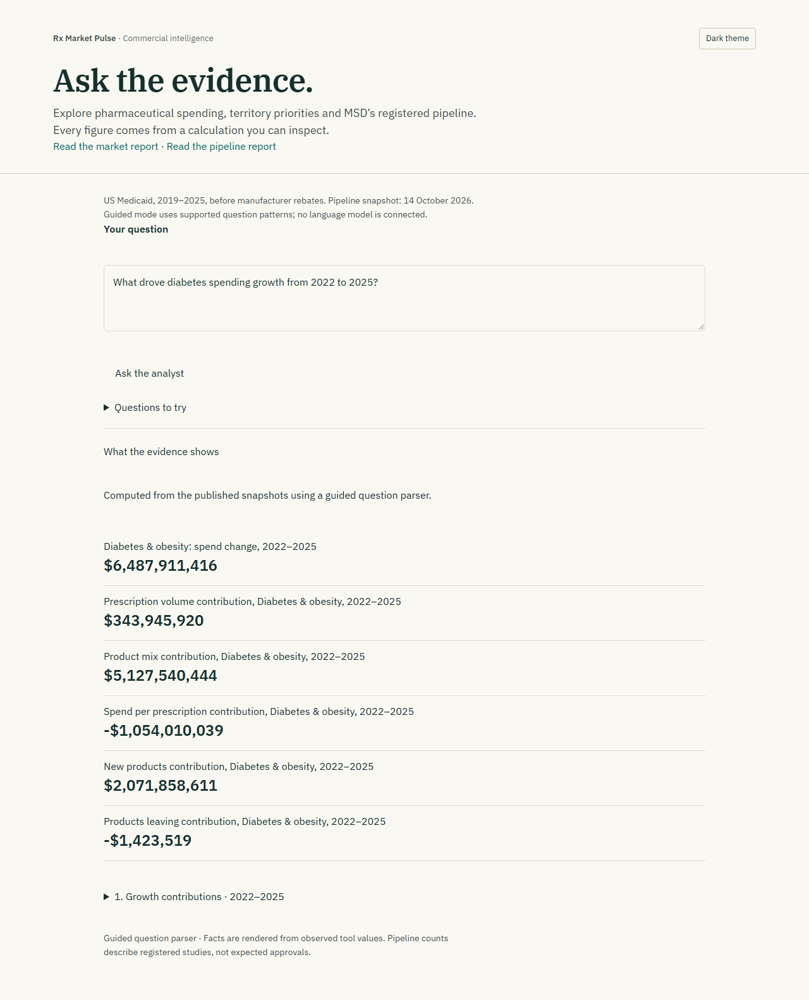

# Commercial Intelligence Agent

Open `/ask` in the dashboard. Questions can investigate market spend, a price/volume/mix bridge, territory priorities, the quarterly forecast and MSD products with related registered studies.

## How answers are grounded

The agent has five read-only, typed tools. It selects tools, reads the results and chooses relevant metric IDs. Final labels and values are rendered directly from those observed metrics; free-form model-generated numbers never enter the factual answer. Each response includes the tool selections, periods, source snapshots, caveats and supporting records. This restricts expressiveness deliberately: correct fact selection still needs evaluation, but a model cannot invent a displayed numeric value.

Tool inputs reject unknown fields, unsupported years and unknown therapeutic areas. The model gets six turns; invalid actions are returned for repair within that same budget, and identical tool calls cannot run twice. There is no arbitrary SQL, Python or external browsing. A failure to select valid observed facts becomes a refusal.

Territory scores use the Excel model's four percentile factors and presets, including the reporting-break adjustment. Nine area/preset scenarios are checked against values computed independently by the existing Python workbook verifier.

The pipeline data is copied from a pinned commit of Trial Pipeline Benchmark. `dashboard/public/data/pipeline/provenance.json` records its commit and file hashes. Refresh with `python tools/sync_pipeline.py ../trial-pipeline-benchmark`, then review the changed snapshot. Study IDs link to their original ClinicalTrials.gov records. Registry study counts are not approval probabilities or forecasts of launches.

## Run

The dashboard defaults to **guided mode**, an explicit deterministic question parser requiring no model or credentials. It is not labelled as LLM inference.

For a local model-backed session, copy `dashboard/.env.local.example` to `dashboard/.env.local`, set `RX_AGENT_PROVIDER=claude-cli` and `RX_AGENT_MODEL=sonnet`, and restart Next.js. Claude Code must already be installed and signed in. Its own tools, customizations and session persistence are disabled; only this application's typed tools run. A subscription inference limit surfaces as a service failure rather than silently switching to guided output.

For hosted model inference, choose `groq` or `gemini` and supply an explicit `RX_AGENT_MODEL` and the matching server-only API key. The local subscription CLI is not available on hosting services. Never expose keys with a `NEXT_PUBLIC_` variable. The route limits input length, checks browser origin, allows two concurrent requests and eight requests per minute per process. Shared production traffic would need a distributed rate limiter.

## Evaluation

`docs/intelligence-evaluation.json` records a real-model run of **20 curated smoke questions**, including combined spending/pipeline questions, different areas and years, territory presets, forecasts and unavailable data. All 20 passed the expected-tool and selected-metric-ID checks. This first smoke run did not score filter-parameter selection independently or retain those parameters; it is not a benchmark estimate of general answer accuracy. The resolved model ID, latency, calls, token usage and API-equivalent cost are saved per case. Those cost estimates are not subscription charges. Future runs also retain selected facts and filters for auditing.

Re-run explicitly from `dashboard` with `RX_AGENT_LIVE_EVAL=1 npm test -- src/lib/intelligence/live-eval.test.ts`. Normal CI never calls a model. Unit tests check bridge reconciliation, independently computed territory scores, source provenance, unsupported inputs, nonexistent metric IDs, multi-tool operation and the turn limit. Browser tests cover asking, inspecting evidence, refusal, quarterly tables, mobile layout and accessibility.
