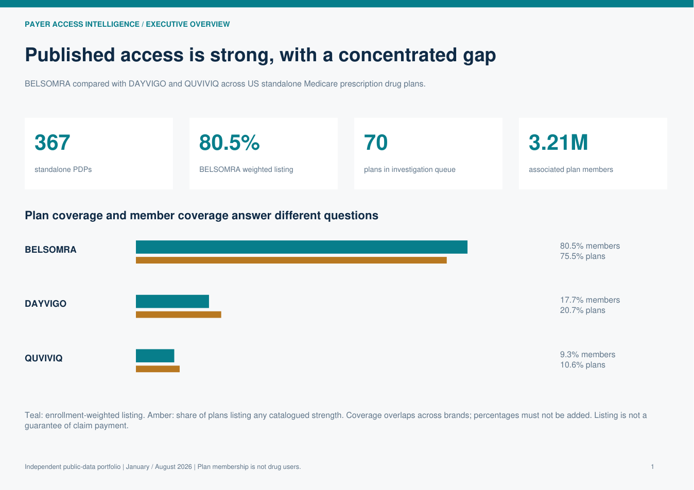
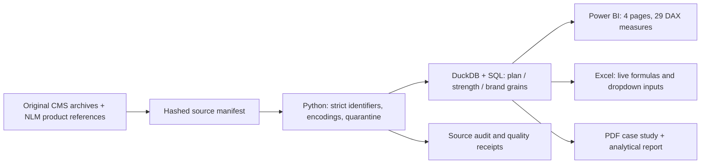

# Payer Access Intelligence

**Which payer access differences should an MSD Commercial Operations analyst investigate first?**

BELSOMRA vs DAYVIGO and QUVIVIQ, using January and August 2026 public Medicare standalone prescription drug plan (PDP) snapshots. Python and SQL transform **2,244,023 original formulary records** into a reproducible analysis of **367 plans and eight product strengths**, a Power BI project, a live-formula Excel workbook and a concise business case.



## Start here

| Deliverable | Open |
|---|---|
| Four-page analytical report | [PDF](outputs/Payer-Access-Analytical-Report.pdf) |
| Two-page interview case study | [PDF](outputs/Payer-Access-Case-Study.pdf) |
| Working Excel analysis | [Workbook](excel/Payer-Access-Intelligence.xlsx) |
| Four-page Power BI project | [PayerAccess.pbip](powerbi/PayerAccess.pbip) |
| Findings and interpretation | [Findings](outputs/findings.md) |
| Definitions and limitations | [Methodology](docs/methodology.md) |
| Reproduction and desktop checks | [Runbook](docs/runbook.md) |

The PDFs and PNGs are generated from the shared SQL marts using PyMuPDF. They are **not Power BI Desktop exports**. The semantic model parses with Microsoft's installed TMDL library; Desktop rendering, DAX execution and saving a PBIX remain pending because this execution environment has no usable interactive application session. Excel COM returns “A specified logon session does not exist.” See [validation status](docs/validation.md) for the exact checks completed.

## What the real data says

- **BELSOMRA:** 277 of 367 plans list all four catalogued strengths. These plans contain **15,253,298 reported members**, or **80.5%** of the observed August cohort. Plan listing share is **75.5%**.
- **DAYVIGO:** 76 listed plans, **17.7%** enrollment-weighted listing. **QUVIVIQ:** 39 listed plans, **9.3%**. Brand coverage overlaps; these percentages must not be added.
- BELSOMRA's weighted listing rate rose from **79.5% to 80.5%**, but **no observed strength listings or PA/ST/QL flags changed** across the matched plans. Both periods give the same 80.5% rate when August enrollment is held fixed. The headline moved with enrollment composition, not expanded listing.
- **70 plans with 3,212,054 reported members** list at least one comparator while BELSOMRA is unlisted. Two contract organizations account for **94.0%** of queue enrollment. These are priorities for payer-document investigation, not estimates of lost sales or patients denied treatment.
- Quantity-limit flags apply in **every listed plan-brand** in this case study. “No prior authorization or step therapy” must not be described as unrestricted access.

## How it works



The source plan list is joined to its assigned formulary within each snapshot. Package-level records collapse to strengths before plan enrollment joins. A plan is counted once per brand and snapshot. Suppressed or missing source access remains unknown. Four enrollment source rows with blank plan IDs are quarantined with their original row references.

## Reproduce without downloading multi-GB archives

Python 3.11+:

```powershell
python -m pip install -e ".[test]"
pai import-slices
pai build
pai export
pai report
python -m pytest -q
```

`data/extracts/` contains checksum-verified UTF-8 derivatives of the original sources, the complete set of source formulary IDs, original row references, full-source row counts and the product catalogue. Every original archive and extracted source file has a retained SHA-256 receipt. Original-source acquisition ran in [this GitHub Actions job](https://github.com/f20230125-sudo/rx-market-pulse/actions/runs/39008455037) because the local sandbox blocks outbound downloads.

To reacquire original bytes from CMS and NLM instead:

```powershell
pai fetch --source-map data/source-map.json
pai build
pai export
pai report
```

Network acquisition errors never trigger a switch to fictional data. `pai preview` creates isolated, conspicuously labeled acceptance fixtures under `outputs/preview/`; those fixtures are excluded from the portfolio package and real findings.

## Interview walkthrough

1. Open the report: explain the difference between the share of plans and the share of members.
2. Show the fixed-enrollment comparison: explain why a better headline did not mean better listing.
3. Filter Excel by brand, strength, region, snapshot and enrollment threshold; trace the selected rows in `Access`.
4. Inspect the 70-plan queue and its concentration. Propose checking current payer documents before action.
5. Show the four quarantined source records and a source-audit row. Explain the treatment of missing and suppressed data.

This is independent portfolio work using public US data. It does not represent MSD's internal systems, the UAE market, clinical recommendations or measured commercial impact.
